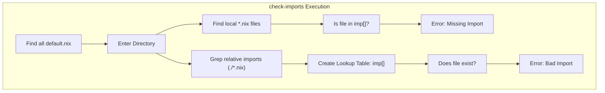
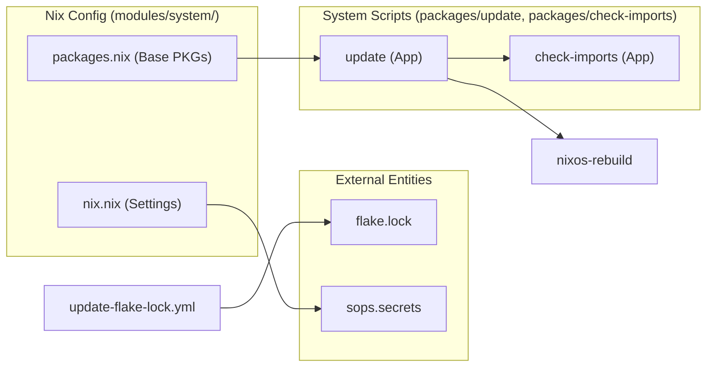

# Getting Started: Building and Updating the System

This guide provides the practical procedures for managing the CodyOS lifecycle. It covers the validation of configuration changes, the automated update pipeline, secret management via SOPS, and the specialized scripts used to maintain repository integrity.

## System Build and Validation

The primary method for applying changes to a host is through `nixos-rebuild`. Before applying changes, engineers should validate the configuration to prevent broken states.

### Testing Changes

To test a configuration without applying it to the bootloader or the running system, use the `dry-run` or `build` operations:

- **Dry Run:**`sudo nixos-rebuild dry-run --flake .#<hostname>`
- **Build:**`nixos-rebuild build --flake .#<hostname>` (This creates a `result` link in the current directory containing the system closure).

### The Update Script

The repository provides a centralized `update` script to standardize the deployment workflow. This script automates formatting, import validation, committing, rebuilding, and pushing the resulting change.

**Implementation Detail:**
The `update` script is defined as a `pkgs.writeShellApplication` in [packages/update/package.nix](../packages/update/package.nix) It is automatically included in the system path via the `environment.systemPackages` list in [modules/system/scripts.nix](../modules/system/scripts.nix)

**Workflow Logic:**

1. **Format:** Runs `nix fmt` on the repository [packages/update/package.nix](../packages/update/package.nix)
2. **Validate:** Executes `check-imports` to ensure no dangling `.nix` files exist [packages/update/package.nix](../packages/update/package.nix)
3. **Commit:** Prompts for a commit message and commits all changes to the local git state [packages/update/package.nix](../packages/update/package.nix)
4. **Rebuild:** Executes `sudo nixos-rebuild switch` to apply the new configuration [packages/update/package.nix](../packages/update/package.nix)
5. **Push:** Synchronizes the local repository with the remote origin [packages/update/package.nix](../packages/update/package.nix)
6. **NAS (optional):** With `update --nas [message]`, it then runs `git pull --ff-only && sudo nixos-rebuild switch` on the NAS over SSH. The NAS evaluates and builds itself; `ssh -t` lets its sudo prompt for a password [packages/update/package.nix](../packages/update/package.nix)

The script does **not** run `nix flake update`. Updating inputs is a separate operator choice.

### NAS Binary Cache and Nightly Builds

The NAS serves its store as a signed binary cache (Harmonia, port 5000, Tailscale only) and pre-builds every host at about 03:00 from GitHub `main` [modules/nas/binary-cache](../modules/nas/binary-cache/default.nix). Beast lists it as its first substituter, so after a nightly run `update` on beast downloads over the LAN instead of compiling. The same job switches the NAS to `main` and also builds the pending `update/flake-lock` PR branch (build only), so merging that PR is already cached.

- Builds are GC-rooted under `/nix/var/nix/gcroots/nightly-build`.
- Run it now: `sudo systemctl start nightly-build` on the NAS; logs via `journalctl -u nightly-build`.
- The signing key is the sops secret `nas-cache-signing-key`; its public half is pinned in [hosts/beast/default.nix](../hosts/beast/default.nix).
- Because the nightly switch follows GitHub `main`, uncommitted edits made directly on the NAS are not deployed by it.

### Related Operator Shortcuts

The Cody Home Manager profile also exposes two shell aliases that cover adjacent workflows:

- `pullUpdate`: `cd /etc/nixos && git pull && sudo nixos-rebuild switch`
- `upgrade`: `cd /etc/nixos && sudo nix flake update && sudo nixos-rebuild switch`

Use `update` when you want to format, validate, commit, rebuild, and push local config changes. Use `pullUpdate` when you want to rebuild the current checkout after pulling remote changes. Use `upgrade` when you want to refresh flake inputs before rebuilding.

---

## Repository Integrity: `check-imports`

A common failure mode in Nix flakes is adding a new `.nix` file to a directory but forgetting to add it to the `imports` list in the corresponding `default.nix`. The `check-imports` utility prevents this.

### Validation Logic

The script performs two primary checks:

1. **Orphaned Files:** It finds all `.nix` files in a directory containing a `default.nix` and verifies they are referenced in that `default.nix`[packages/check-imports/package.nix](../packages/check-imports/package.nix)
2. **Broken Links:** It verifies that every relative import (e.g., `./module.nix`) in a `default.nix` actually points to an existing file [packages/check-imports/package.nix](../packages/check-imports/package.nix)

### Technical Implementation

The script uses `findutils` and `grep` to parse the AST-lite of the Nix files.

**Data Flow: Import Validation**

---

## Secret Management with SOPS

CodyOS uses `sops-nix` for secret management. Secrets are encrypted with Age keys and decrypted at runtime.

### Private Flake Integration

To access private resources, such as the `nixos-secrets` repository, the system configures GitHub access tokens via SOPS templates.

**Implementation in `modules/system/nix.nix`:**

1. **Secret Declaration:** The system expects a secret named `github-nix-secrets-read`[modules/system/nix.nix8](../modules/system/nix.nix#L8-L8)
2. **Template Generation:** A configuration file `nix-access-tokens.conf` is generated, injecting the decrypted token into a format Nix understands: `access-tokens = github.com=${token}`[modules/system/nix.nix9-16](../modules/system/nix.nix#L9-L16)
3. **Nix Integration:** The system Nix configuration includes this generated file via `extraOptions`[modules/system/nix.nix19-21](../modules/system/nix.nix#L19-L21)

---

## Automated Maintenance (CI)

The repository uses GitHub Actions to keep `flake.lock` current and to validate pull requests without exposing private flake credentials.

### Flake Lock Update Workflow

A workflow runs on manual dispatch, every Sunday at 4:00 AM UTC, and on pull requests opened, synchronized, or reopened [.github/workflows/update-flake-lock.yml2-7](../.github/workflows/update-flake-lock.yml#L2-L7)

**CI Pipeline Steps:**

1. **PR Formatting and Lint Check:** Pull requests always run the public-safe `nixfmt-tree --ci .`, `statix check`, and `deadnix --fail` checks without evaluating the local flake [.github/workflows/update-flake-lock.yml12-22](../.github/workflows/update-flake-lock.yml#L12-L22)
2. **PR Flake Check:** Pull requests run `nix flake check --print-build-logs` only when the `NIX_SECRETS_READ` secret is available; otherwise the private flake check is skipped [.github/workflows/update-flake-lock.yml24-46](../.github/workflows/update-flake-lock.yml#L24-L46)
3. **Scheduled or Manual Update:** Non-PR runs require `NIX_SECRETS_READ`, run `nix flake update`, then run `nix flake check --print-build-logs` [.github/workflows/update-flake-lock.yml48-77](../.github/workflows/update-flake-lock.yml#L48-L77)
4. **PR Creation:** If changes are detected, the workflow opens or updates `update/flake-lock` with title `chore(flake): update inputs` and labels `dependencies`, `automated`, and `nix` [.github/workflows/update-flake-lock.yml78-91](../.github/workflows/update-flake-lock.yml#L78-L91)

`nix flake check` evaluates both hosts and runs the flake's `checks.x86_64-linux`: `formatting` (nixfmt), `statix` (lint rules in `statix.toml`), `deadnix` (unused bindings), and `imports` (`check-imports` against the flake source). Run it locally before `update` for the same result.

### Garbage Collection

To prevent the Nix store from consuming excessive disk space, automatic garbage collection is configured at the system level in [modules/system/nix.nix37-41](../modules/system/nix.nix#L37-L41) It is set to run **weekly** and delete any generations older than **7 days**.

---

## System Configuration Map

The following diagram maps the relationship between the management scripts and the system configuration entities.

**Entity Mapping: Build and Update Tools**

