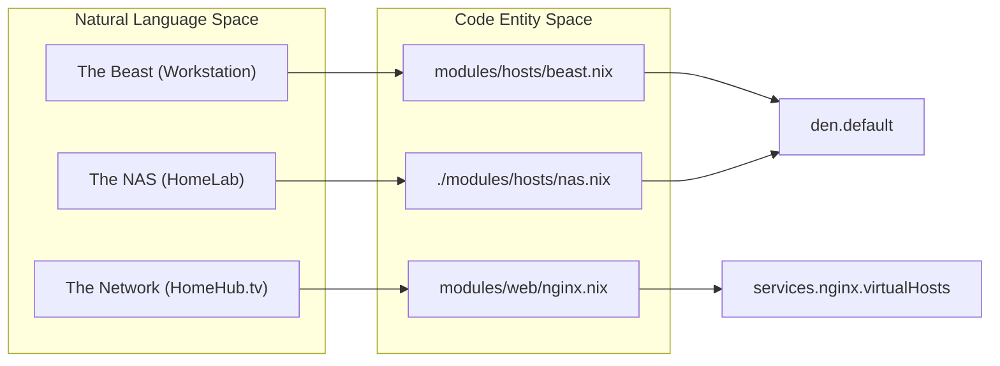
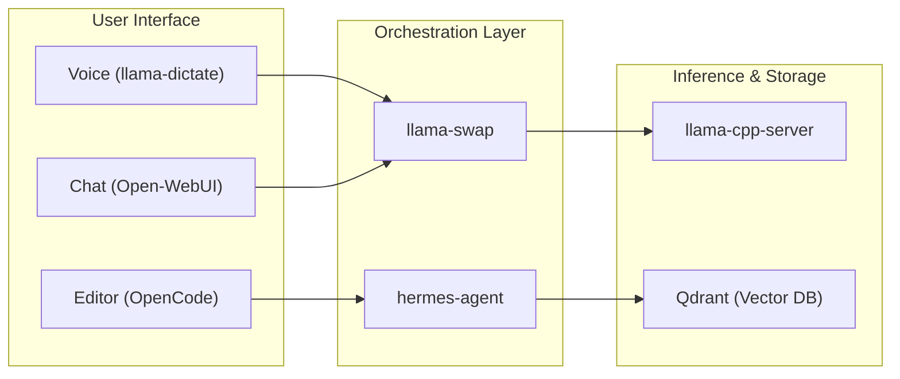

# Glossary

This page provides definitions for codebase-specific terms, jargon, and domain concepts used throughout CodyOS. It serves as a technical reference for onboarding engineers to understand how abstract names in the documentation map to concrete Nix expressions and system services.

## Core Infrastructure Terms

| Term        | Definition                                                                      | Implementation Pointer                                                                                                                          |
| ----------- | ------------------------------------------------------------------------------- | ----------------------------------------------------------------------------------------------------------------------------------------------- |
| **Beast**   | The high-performance desktop workstation host (Intel i9-14900KF / NVIDIA 3070). | [modules/hosts/beast.nix](../modules/hosts/beast.nix) |
| **NAS**     | The home lab / NAS host (Intel i5-14400F, NVIDIA GTX 1650) providing centralized services. | [modules/hosts/nas.nix](../modules/hosts/nas.nix)                                              |
| **HomeHub** | The primary domain (`homehub.tv`) used for internal web services.               | [modules/web/homepage.nix](../modules/web/homepage.nix) |
| **Stylix**  | The system-wide theming engine used to unify colors across CLI and GUI.         | [modules/graphical/theming.nix](../modules/graphical/theming.nix)                                                   |
| **SOPS**    | Secrets Operations; used for encrypted secret management within the flake.      | [modules/secrets.nix](../modules/secrets.nix)                                                   |

**Architecture Mapping: Infrastructure to Code**

Sources:[modules/hosts/nas.nix](../modules/hosts/nas.nix)[modules/web/nginx.nix](../modules/web/nginx.nix)

## AI & Agent Domain Concepts

### Hermes Agent

The primary autonomous assistant. It is a complex service involving multiple sub-modules for skills, toolsets, and memory.

- **SkillPack**: A collection of tools/functions available to Hermes.
- **Holographic Memory**: The persistence layer for the agent's long-term context.
- **CRM_DB**: The database path for the CLI-first CRM used by the agent.

### llama-swap

A custom orchestration service that manages LLM (Large Language Model) lifecycles. It supports TTL-based (Time-To-Live) swapping of models to optimize VRAM usage.

- **Model Catalog**: Defined in `models.nix`, specifying parameters like `gpuLayers`, `contextSize`, and `ttl`.
- **Resident Model**: A model with `ttl = 0`, meaning it stays in VRAM indefinitely.

### OpenCode

The AI coding harness integrated into Neovim and the desktop environment. It provides specialized agents (e.g., `verifier`, `business`) and sub-agents for development tasks.

**Logic Flow: AI Service Interaction**

Sources: [modules/ai/hermes-agent/_hm/default.nix](../modules/ai/hermes-agent/_hm/default.nix)[modules/ai/llama-swap/_impl/models.nix](../modules/ai/llama-swap/_impl/models.nix)[modules/graphical/_hyprland/settings.nix](../modules/graphical/_hyprland/settings.nix)

## Server & Media Jargon

- **Arr Suite**: Refers to the collection of media management tools: `Sonarr` (TV), `Radarr` (Movies), `Readarr` (Books), `Lidarr` (Music), and `Prowlarr` (Indexers). [modules/media/media.nix](../modules/media/media.nix)
- **VPN Confinement**: A mechanism using network namespaces to force specific services (like `transmission`) to only communicate via a Wireguard interface. [modules/media/media.nix](../modules/media/media.nix)
- **Kobo Sync**: A specialized configuration for `calibre-web` to allow e-readers to synchronize libraries over the network. [modules/media/media.nix](../modules/media/media.nix)
- **Miniflux Curator**: A Python-based automation script that uses LLM embeddings to score RSS articles and auto-read low-score content. [modules/feeds/miniflux.nix](../modules/feeds/miniflux.nix)
- **ACME/Cloudflare**: The automated pipeline for generating wildcard SSL certificates for `*.homehub.tv` using DNS-01 challenges. [modules/web/nginx.nix](../modules/web/nginx.nix)

## Desktop & Environment Terms

- **Special Workspaces**: Hyprland "scratchpads" used for persistent background tasks like `special:ai`, `special:dev`, and `special:chat`. [modules/graphical/_hyprland/settings.nix](../modules/graphical/_hyprland/settings.nix)
- **MainMod**: The primary modifier key for desktop shortcuts, defined as `SUPER` (Windows key). [modules/graphical/_hyprland/settings.nix](../modules/graphical/_hyprland/settings.nix)
- **Focus-or-Run**: A custom script logic that either switches focus to an existing window of a specific class or launches the application if not found. [modules/graphical/_hyprland/settings.nix](../modules/graphical/_hyprland/settings.nix)
- **Hermes Voice**: The Waybar module providing visual feedback for the voice-activated LLM interface (VAD, STT, TTS).

