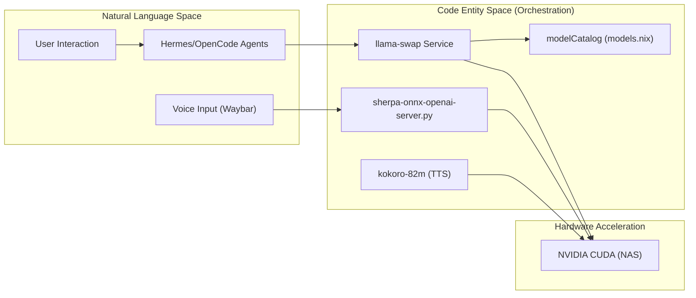
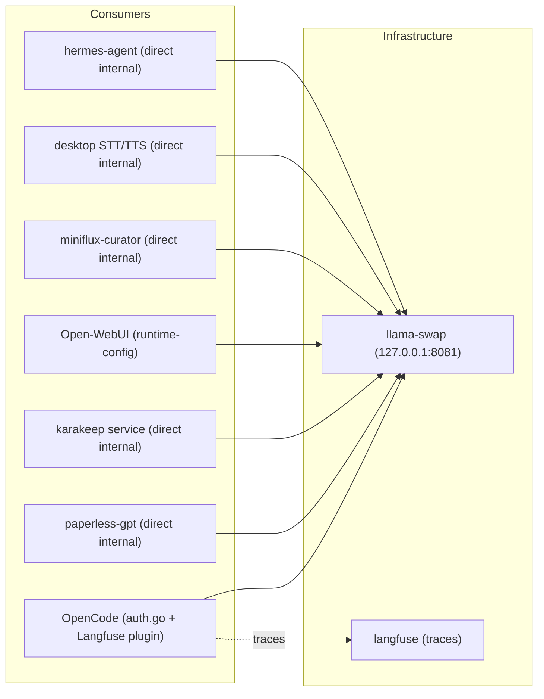

# Local AI Infrastructure

The CodyOS AI stack provides a unified, local-first interface for Large Language Models (LLMs), Speech-to-Text (STT), and Text-to-Speech (TTS) services. It is designed to run primarily on the **NAS** server, utilizing NVIDIA hardware acceleration to serve low-latency inference to local agents, desktop tools, and remote services via an OpenAI-compatible API.

## High-Level Architecture

The infrastructure is built around a "model swapping" pattern where large models are loaded into VRAM on-demand and evicted after a period of inactivity. This allows a single GPU (NVIDIA RTX 5060 on NAS) to serve multiple specialized models (chat, embedding, vision, OCR) without exceeding memory limits.

### AI Infrastructure Flow

This diagram illustrates how user input moves from desktop interactions through the orchestration layer to the hardware backends.

---

## [llama-swap: LLM Orchestration Service](/Cody-W-Tucker/nix-config/5.1-llama-swap:-llm-orchestration-service)

`llama-swap` is the central orchestration service that manages the lifecycle of LLM processes. It exposes an OpenAI-compatible endpoint that dynamically launches `llama-server` instances based on the requested model.

- **Model Management:** Models are defined in a central catalog [modules/ai/llama-swap/_impl/models.nix](../modules/ai/llama-swap/_impl/models.nix) Each entry specifies `gpuLayers`, `contextSize`, and `ttl` (Time-To-Live).
- **TTL-Based Swapping:** The service keeps a model resident in VRAM for a specified `ttl` duration [modules/ai/llama-swap/default.nix](../modules/ai/llama-swap/default.nix) Once the idle timer expires, the process is killed to free resources.
- **Acceleration Backends:** Supports `cuda` (default for NAS)
- **Vision/OCR Support:** Multimodal models like `glm-ocr-f16` utilize a `mmprojFile` to handle image inputs [modules/ai/llama-swap/_impl/models.nix](../modules/ai/llama-swap/_impl/models.nix)

For details, see [llama-swap: LLM Orchestration Service](/Cody-W-Tucker/nix-config/5.1-llama-swap:-llm-orchestration-service).

---

## [Speech-to-Text and Text-to-Speech Services](/Cody-W-Tucker/nix-config/5.2-speech-to-text-and-text-to-speech-services)

The system provides a low-latency voice pipeline for desktop interaction, primarily consumed by the `hermes-waybar-voice` assistant and the `llama-dictate` script.

- **STT Pipeline:** Primary STT is `parakeet-tdt-v3`: Nixpkgs `sherpa-onnx` running NVIDIA Parakeet TDT 0.6B v3 int8 on CUDA, wrapped in an OpenAI-compatible server ([modules/ai/llama-swap/_impl/sherpa-onnx-openai-server.py](../modules/ai/llama-swap/_impl/sherpa-onnx-openai-server.py)). There is no STT fallback model; speaker-aware transcription is served separately by `whisper-diarization`.
- **TTS Pipeline:** Supports Kokoro-82M for high-quality speech synthesis via an OpenAI-compatible API [modules/ai/llama-swap/kokoro-openai-server.py](../modules/ai/llama-swap/kokoro-openai-server.py)
- **Integration:** These services are configured as the primary STT/TTS providers for the `hermes-agent`[modules/ai/hermes-agent/_hm/default.nix](../modules/ai/hermes-agent/_hm/default.nix)

For details, see [Speech-to-Text and Text-to-Speech Services](/Cody-W-Tucker/nix-config/5.2-speech-to-text-and-text-to-speech-services).

---

## [Beast AI Stack: Open-WebUI and Qdrant](/Cody-W-Tucker/nix-config/5.3-beast-ai-stack:-open-webui-and-qdrant)

On the **beast** host, a suite of higher-level AI tools provides user-facing interfaces and Retrieval-Augmented Generation (RAG) capabilities.

- **Open-WebUI:** The primary graphical interface for interacting with local and remote LLMs. It is configured to use the local `llama-swap` endpoint.
- **Qdrant:** A vector database used for storing and searching document embeddings, enabling RAG for local knowledge bases like Obsidian.
- **Content Extraction:** Integrated with Apache Tika for extracting text from various file formats for ingestion into the vector store.

For details, see [Beast AI Stack: Open-WebUI and Qdrant](/Cody-W-Tucker/nix-config/5.3-beast-ai-stack:-open-webui-and-qdrant).

---

## llama-swap Gateway: Direct OpenAI-Compatible Access

The NAS exposes **llama-swap directly** at `127.0.0.1:8081` (see `modules/ai/llama-swap/_nas-models.nix`); every consumer hits llama-swap's OpenAI-compatible `/v1` API on the internal loopback endpoint.

- **Local routes:** Every enabled `services.llama-swap.enabledModels` entry is served directly under its llama-swap model id (`qwen3.5-0.8b`, `qwen-3.5-4b`, `qwen3-embedding-0.6b`, `glm-ocr-f16`, `parakeet-tdt-v3`, `whisper-diarization`, `kokoro-82m`).
- **No gateway auth:** llama-swap requires no API key. Gateway clients (Karakeep, Paperless-GPT, the Miniflux curator) use a declarative dummy `OPENAI_API_KEY` to satisfy OpenAI-client env plumbing — no secret material is involved.
- **Direct internal clients (`127.0.0.1:8081/v1`):** Hermes STT/TTS, desktop speech-to-text, the Waybar helper, the Miniflux curator, Karakeep, and Paperless-GPT reach llama-swap directly on the NAS host.
- **OpenCode observability:** OpenCode (including the web service) loads `@langfuse/opencode-observability-plugin@0.5.2` for LLM tracing. Its `LANGFUSE_*` credentials come from the `opencode-langfuse-env` SOPS template (modules/ai/llama-swap/_nas-models.nix): the secret's env-file payload plus a declarative `LANGFUSE_BASE_URL`, exposed as a codyt-owned `0400` EnvironmentFile.
- **Hosted models:** OpenCode sessions use the `opencode-go` provider (e.g. `opencode-go/hy3` in the nixvim 99 plugin and Hermes agent config), not a shared gateway catalogue.

---

## Code Entity Mapping

The following table maps conceptual infrastructure components to their implementation in the codebase.

| System Name        | Implementation File                                                                                                                                                                      | Key Function/Attribute                                                                               |
| ------------------ | ---------------------------------------------------------------------------------------------------------------------------------------------------------------------------------------- | ---------------------------------------------------------------------------------------------------- |
| **Model Catalog**  | [modules/ai/llama-swap/_impl/models.nix](../modules/ai/llama-swap/_impl/models.nix)                                               | Attribute set of model configs                                                                       |
| **Orchestrator**   | [modules/ai/llama-swap/default.nix](../modules/ai/llama-swap/default.nix)                                             | `mkModelCommand`[128-162](../128-162)         |
| **STT Server**     | [modules/ai/llama-swap/_impl/sherpa-onnx-openai-server.py](../modules/ai/llama-swap/_impl/sherpa-onnx-openai-server.py)       | `transcriptions` endpoint |
| **Kokoro TTS**     | [modules/ai/llama-swap/kokoro-openai-server.py](../modules/ai/llama-swap/kokoro-openai-server.py) | `speech` endpoint, voice mapping [17-26](../17-26)       |
| **NVIDIA Config**  | [modules/hardware/nvidia.nix](../modules/hardware/nvidia.nix)                                                                     | `codyos.hardware.nvidia`, `hardware.nvidia.open` |

### Service Consumption Diagram

This diagram shows how various system services consume the AI infrastructure via the `http://nas:8081/v1` API.

