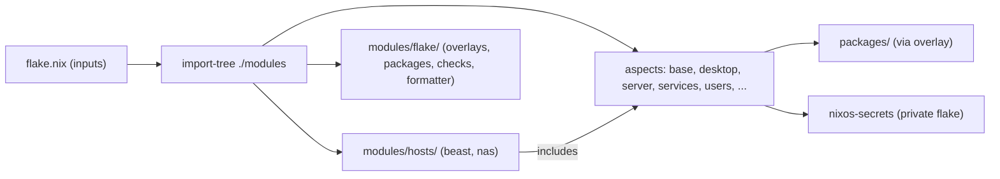
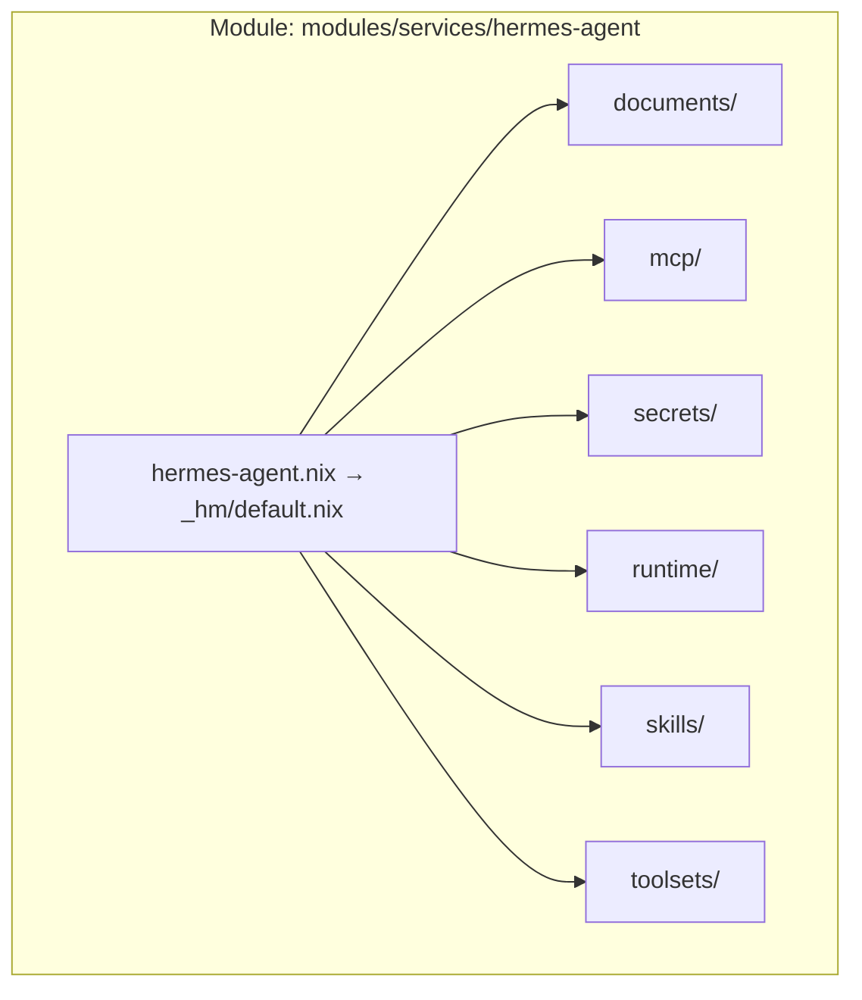

# Repository Structure and Conventions

This page details the organizational standards, directory layout, and naming conventions of the CodyOS repository. Everything that defines a machine is a [Den](https://github.com/denful/den) flake-level module under `modules/`; see [Den-Native-Layout.md](Den-Native-Layout.md) for the full tree and conventions.

## Top-Level Directory Layout

| Directory     | Purpose                                                            | Key Contents                                  |
| ------------- | ------------------------------------------------------------------ | --------------------------------------------- |
| `modules/`    | The Den tree: hosts, aspects, flake outputs. Loaded by `import-tree`. | `hosts/`, `base/`, `hardware/`, `users/`, `desktop/`, `editor/`, `harness/`, `services/`, `server/`, `flake/` |
| `packages/`   | Custom derivations and system scripts, exposed by the shared overlay and as `packages.x86_64-linux`. | `update/`, `check-imports/`, `kokoro-assets/` |
| `docs/`       | Longer operator notes and reference material.                      | this directory                                |
| `.agents/`    | Knowledge base and guidance for AI agents.                         | `skills/`                                     |
| `wallpapers/` | Wallpaper assets referenced by desktop configuration.              | Static image assets                           |

`flake.nix` holds only inputs and the `evalModules` call that turns `modules/` into the flake outputs.

### System Architecture Data Flow

**CodyOS Configuration Data Flow**



---

## Naming and File Conventions

### 1. Case and Format

- **kebab-case:** All file and directory names must use lowercase kebab-case (e.g., `homepage-dashboard.nix`) [CONTRIBUTING.md](../CONTRIBUTING.md)
- **Secret Keys:** Use quoted attribute names for secret keys containing dashes, such as `sops.secrets."paperless-password"` [AGENTS.md](../AGENTS.md)

### 2. Underscore Paths and `default.nix`

- A non-underscore `.nix` under `modules/` is a flake-level Den module. Plain NixOS/Home Manager modules, package files and data live under `_` paths (import-tree skips any path containing `/_`) and are imported explicitly by their aspect.
- No `default.nix` outside `_` paths. Inside `_` subtrees `default.nix` may remain a short import aggregator; `check-imports` verifies that sibling files are referenced from it.
- Keep `default.nix` short; move implementation details to sibling files like `package.nix`, `service.nix`, or `module.nix` [AGENTS.md](../AGENTS.md)
- **Example structure:**

```
modules/services/hermes-agent/
├── hermes-agent.nix   # den.aspects.hermes-agent (flake-level module)
└── _hm/               # plain Home Manager module tree
    ├── default.nix    # the "spine" that imports the rest
    ├── documents/     # Workspace documents and SOUL installation
    ├── mcp/           # MCP server wiring
    ├── runtime/       # Systemd and environment setup
    ├── secrets/       # SOPS wiring
    ├── skills/        # Managed and mutable skills
    └── toolsets/      # Tool exposure and trust boundaries
```

### 3. Roles, Aspects and Host Facts

- **Roles** are aspects that include other aspects: `den.aspects.desktop` ([`modules/desktop/desktop.nix`](../modules/desktop/desktop.nix)), `den.aspects.server` ([`modules/server/server.nix`](../modules/server/server.nix)) and `den.aspects.base` ([`modules/base/base.nix`](../modules/base/base.nix)). Host aspects in [`modules/hosts/`](../modules/hosts) include the roles and features they want.
- **Features** are aspects (`den.aspects.<name>` with `nixos` and/or `homeManager`). Including an aspect turns it on; there are no `codyos.<name>.enable` flags. Option-carrying `codyos.*` settings that remain are declared next to their consumer (e.g. `codyos.site` in [`modules/base/site.nix`](../modules/base/site.nix)).
- **Host facts** (`channel`, `localAi`, `lan`, `tailscale`, `mac`, `hardwareConfig`, `nvidiaPowerLimit`) are attributes on the `den.hosts` entry and are read by aspects from the `host` context.

```nix
den.aspects.beast.includes = [
  den.aspects.base
  den.aspects.desktop
  den.aspects.nvidia
];
```

### 4. Site Facts ()

Values shared across hosts live in one place, [modules/base/site.nix](../modules/base/site.nix):

| Option | Value |
| --- | --- |
| `domain` | `homehub.tv` |
| `user.name` / `user.home` / `user.email` | `codyt` / `/home/codyt` / primary email |
| `lan.subnet`, `lan.gateway`, `lan.broadcast` | `192.168.1.0/24`, `.1`, `.255` |
| `hosts.<name>.lan` / `.tailscale` / `.mac` | per-machine addresses for `nas` and `beast` |

NixOS modules read them from `config.codyos.site`; Home Manager modules use `osConfig.codyos.site`. For example:

```nix
let
  inherit (config.codyos.site) domain;
in
{
  services.nginx.virtualHosts = mkNginxVhost {
    host = "mealie.${domain}";
    port = 9000;
  };
}
```

---

## Flake Inputs and Categories

The `flake.nix` file categorizes inputs to balance system stability with the need for cutting-edge desktop features.

### Input Tiers

- **Stable (`nixpkgs`):** Tracks `nixos-26.05`. Primarily used for the `nas` host to ensure uptime and service reliability [flake.nix](../flake.nix)
- **Unstable (`nixpkgs-unstable`):** Tracks `nixos-unstable`. Used for the `beast` workstation to provide the latest Hyprland, AI tools, and kernel updates [flake.nix](../flake.nix)

### Key AI & Agent Inputs

The repo integrates several specialized flakes for the local AI stack:

- `hermes-agent`: The primary cognitive assistant runtime [flake.nix](../flake.nix)
- `llm-agents`: A collection of AI tool pack derivations [flake.nix](../flake.nix)

---

## Agent Guidance (AGENTS.md)

The repository contains `AGENTS.md` files scattered throughout the tree. These files serve as "in-situ" documentation for LLMs (like Claude or GPT-4) when they are operating within the codebase.

### Global Rules [AGENTS.md](../AGENTS.md)

- **Git Tracking:** New files must be `git add`-ed before Nix flakes can see them.
- **No Raw Secrets:** Never commit unencrypted secrets; use `sops-nix`.
- **Validation:** Evaluate merged configuration instead of scanning source; do not activate or switch without authorization.

### Directory-Specific Guidance

- **[`modules/hosts/AGENTS.md`](../modules/hosts/AGENTS.md)**: Keep host files to machine facts, role selection and wiring.
- **[`modules/users/AGENTS.md`](../modules/users/AGENTS.md)**, **[`modules/desktop/AGENTS.md`](../modules/desktop/AGENTS.md)**, **[`modules/server/AGENTS.md`](../modules/server/AGENTS.md)**, **[`modules/harness/AGENTS.md`](../modules/harness/AGENTS.md)**: placement rules for each area, including declaring secrets close to the consuming service.
- **[`modules/README.md`](../modules/README.md)**: the module tree overview, how to add a host or aspect.

---

## Module Logic and Implementation

Modules are designed to be single-purpose and self-contained. an aspect file (or a `_` module tree with a short `default.nix` spine) assembles the module, while runtime wiring, secrets, package overrides, MCP integrations, and related support surfaces live in sibling paths when the module grows.

### Service Implementation Pattern



### Nginx and Secrets Wiring

For services like `hermes-agent`, the configuration is made fully declarative by writing the settings to a JSON file and forcing the activation script to overwrite the upstream `config.yaml`[modules/services/hermes-agent/_hm/default.nix](../modules/services/hermes-agent/_hm/default.nix) Secrets are injected via `sops.templates`, allowing dynamic environment variables to be populated at runtime [modules/services/hermes-agent/_hm/default.nix](../modules/services/hermes-agent/_hm/default.nix)
