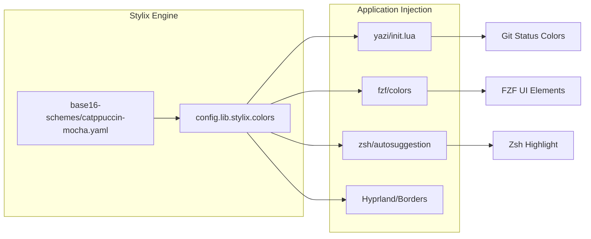
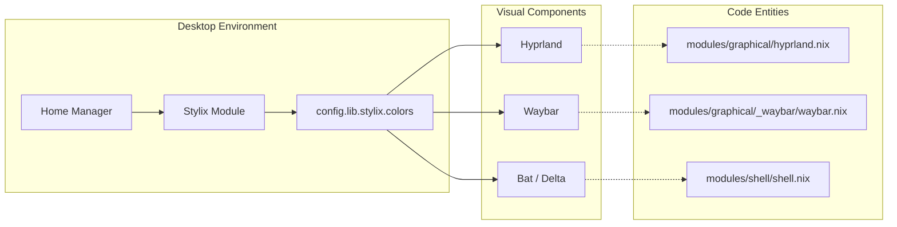

# Theming and Styling (Stylix)

The CodyOS theming architecture is powered by **Stylix**, a declarative theming layer that feeds colors, fonts, cursor settings, and related desktop styling into Home Manager applications and desktop configuration.

## Where To Look

- `modules/graphical/theming.nix`: the `graphical` aspect's theming file (Stylix part is Home Manager only): Stylix enablement, base16 scheme, GTK icon override, and shared desktop theme settings such as polarity, opacity, cursor, fonts, wallpaper, and target overrides [modules/graphical/theming.nix](../modules/graphical/theming.nix)
- The same file also sets system-level font availability for the workstation (beast only; the headless NAS installs no fonts)

## Configuration Split

The main thing to know is that the desktop theming surface is split across two layers:

- `modules/graphical/theming.nix` contributes to the `graphical` aspect (Home Manager half, delivered through `provides.to-users.homeManager`); it owns the shared Stylix settings and imports the Stylix Home Manager module, so `config.lib.stylix` exists only on hosts that include `graphical`.
- Consumers elsewhere guard on it: `modules/shell/shell.nix` (yazi, fzf) checks `config.lib ? stylix`; `modules/graphical/_waybar/waybar.nix` and `modules/graphical/_hyprland/settings.nix` read the colors directly.

## Application Integration and Data Flow

Stylix values are injected into application configurations through the `config.lib.stylix.colors` attribute set. This allows for dynamic theming of tools that do not natively support Stylix or require custom logic.

### Implementation Diagram: Color Injection

The following diagram illustrates how the `base16Scheme` is processed by Stylix and distributed to specific application configurations.

Title: Stylix Color Distribution Flow

### Specific Integrations

#### 1. Yazi (File Manager)

Yazi uses Stylix colors to theme its Git integration via custom Lua initialization. Colors are mapped from the base16 palette to specific Git states:

- **Modified**: `base0A` (Yellow) [modules/shell/shell.nix](../modules/shell/shell.nix)
- **Added**: `base0B` (Green) [modules/shell/shell.nix](../modules/shell/shell.nix)
- **Deleted**: `base08` (Red) [modules/shell/shell.nix](../modules/shell/shell.nix)
- **Untracked**: `base0C` (Cyan) [modules/shell/shell.nix](../modules/shell/shell.nix)

#### 2. FZF (Fuzzy Finder)

The Stylix `fzf` target is disabled (`stylix.targets.fzf.enable = false` in [modules/graphical/theming.nix](../modules/graphical/theming.nix)); `programs.fzf.colors` in `modules/shell/shell.nix` sets the palette itself from `config.lib.stylix.colors`, guarded by `lib.mkIf (config.lib ? stylix)` so hosts without Stylix skip it:

- `fg+` (Current match) and `pointer` use `base0D` [modules/shell/shell.nix](../modules/shell/shell.nix)
- `prompt` uses `base03` [modules/shell/shell.nix](../modules/shell/shell.nix)

#### 3. Terminal and Shell

- **Kitty**: Automatically themed by Stylix, with a specific override in the graphical theming [modules/graphical/theming.nix](../modules/graphical/theming.nix)
- **Zsh**: The `autosuggestion.highlight` uses the Stylix palette directly [modules/graphical/theming.nix](../modules/graphical/theming.nix)

## UI Component Configuration

Title: Desktop UI Component Mapping

### Manual Overrides and Exceptions

While Stylix manages most of the environment, certain applications are excluded or handled manually:

- **NixVim**: Stylix integration is disabled (`nixvim.enable = false`) to allow the editor's internal Catppuccin theme to handle specialized syntax highlighting [modules/graphical/theming.nix](../modules/graphical/theming.nix)
- **GTK**: Icons are manually set to the Adwaita theme rather than letting Stylix determine the icon pack [modules/graphical/theming.nix](../modules/graphical/theming.nix)
- **Waybar, Hyprlock, FZF**: Stylix targets are disabled because local config fully replaces them (`modules/graphical/_waybar/waybar.nix`, `modules/graphical/_hyprland/settings.nix`, `modules/shell/shell.nix`) [modules/graphical/theming.nix](../modules/graphical/theming.nix)
- **Rofi**: Stylix still supplies colors, but its font is disabled (`rofi.fonts.enable = false`) because `modules/graphical/launcher.nix` sets its own [modules/graphical/theming.nix](../modules/graphical/theming.nix)
- **Dconf**: The GNOME target is disabled, so `modules/graphical/theming.nix` sets the desktop color-scheme preference from Stylix polarity directly for applications that follow the system preference.
