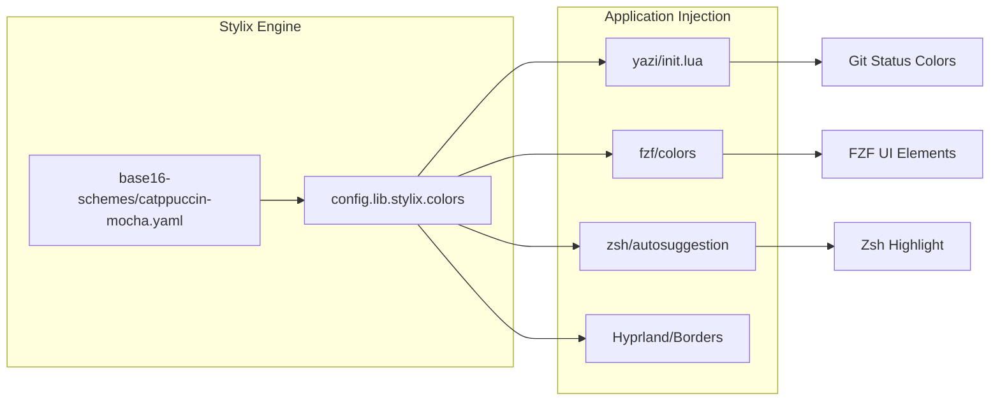
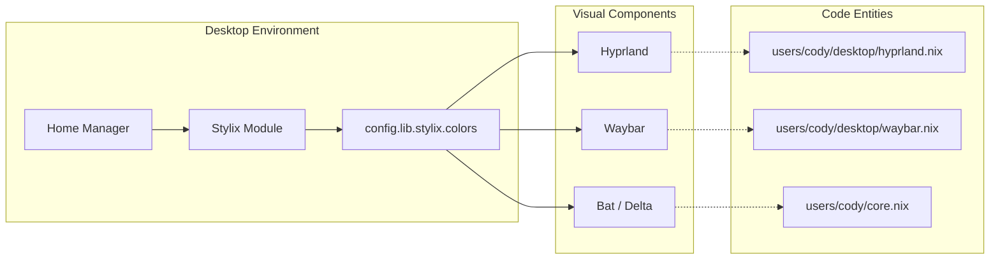

# Theming and Styling (Stylix)

The CodyOS theming architecture is powered by **Stylix**, a declarative theming layer that feeds colors, fonts, cursor settings, and related desktop styling into Home Manager applications and desktop configuration.

## Where To Look

- `users/cody/desktop.nix`: top-level Stylix enablement and shared desktop theme settings such as polarity, opacity, cursor, fonts, wallpaper, and target overrides [users/cody/desktop.nix30-79](../users/cody/desktop.nix#L30-L79)
- `users/cody/desktop/default.nix`: desktop role module imports plus the base16 scheme and GTK icon override [users/cody/desktop/default.nix8-43](../users/cody/desktop/default.nix#L8-L43)
- `modules/desktop/fonts.nix`: system-level font availability for the desktop profile (beast only; the headless NAS installs no fonts) [modules/desktop/fonts.nix6-15](../modules/desktop/fonts.nix#L6-L15)

## Configuration Split

The main thing to know is that the desktop theming surface is split across two layers:

- `users/cody/desktop.nix` is the Home Manager desktop role entrypoint and owns the shared Stylix settings.
- `users/cody/desktop/default.nix` is the imported desktop module surface where desktop-specific modules and a few theme-adjacent overrides live.

## Application Integration and Data Flow

Stylix values are injected into application configurations through the `config.lib.stylix.colors` attribute set. This allows for dynamic theming of tools that do not natively support Stylix or require custom logic.

### Implementation Diagram: Color Injection

The following diagram illustrates how the `base16Scheme` is processed by Stylix and distributed to specific application configurations.

Title: Stylix Color Distribution Flow

### Specific Integrations

#### 1. Yazi (File Manager)

Yazi uses Stylix colors to theme its Git integration via custom Lua initialization. Colors are mapped from the base16 palette to specific Git states:

- **Modified**: `base0A` (Yellow) [users/cody/core.nix83](../users/cody/core.nix#L83-L83)
- **Added**: `base0B` (Green) [users/cody/core.nix84](../users/cody/core.nix#L84-L84)
- **Deleted**: `base08` (Red) [users/cody/core.nix85](../users/cody/core.nix#L85-L85)
- **Untracked**: `base0C` (Cyan) [users/cody/core.nix87](../users/cody/core.nix#L87-L87)

#### 2. FZF (Fuzzy Finder)

The Stylix `fzf` target is disabled (`stylix.targets.fzf.enable = false` in [users/cody/desktop.nix39](../users/cody/desktop.nix#L39-L39)); `programs.fzf.colors` in `users/cody/core.nix` sets the palette itself from `config.lib.stylix.colors`, guarded by `lib.mkIf (config.lib ? stylix)` so hosts without Stylix skip it:

- `fg+` (Current match) and `pointer` use `base0D` [users/cody/core.nix113-120](../users/cody/core.nix#L113-L120)
- `prompt` uses `base03` [users/cody/core.nix118](../users/cody/core.nix#L118-L118)

#### 3. Terminal and Shell

- **Kitty**: Automatically themed by Stylix, with a specific override in the desktop role [users/cody/desktop.nix44-46](../users/cody/desktop.nix#L44-L46)
- **Zsh**: The `autosuggestion.highlight` uses the Stylix palette directly [users/cody/desktop.nix21](../users/cody/desktop.nix#L21-L21)

## UI Component Configuration

Title: Desktop UI Component Mapping

### Manual Overrides and Exceptions

While Stylix manages most of the environment, certain applications are excluded or handled manually:

- **NixVim**: Stylix integration is disabled (`nixvim.enable = false`) to allow the editor's internal Catppuccin theme to handle specialized syntax highlighting [users/cody/desktop.nix35](../users/cody/desktop.nix#L35-L35)
- **GTK**: Icons are manually set to the Adwaita theme rather than letting Stylix determine the icon pack [users/cody/desktop/default.nix37-43](../users/cody/desktop/default.nix#L37-L43)
- **Waybar, Hyprlock, FZF**: Stylix targets are disabled because local config fully replaces them (`desktop/waybar.nix`, `desktop/hyprland.nix`, `core.nix`) [users/cody/desktop.nix36-39](../users/cody/desktop.nix#L36-L39)
- **Rofi**: Stylix still supplies colors, but its font is disabled (`rofi.fonts.enable = false`) because `desktop/rofi.nix` sets its own [users/cody/desktop.nix40-41](../users/cody/desktop.nix#L40-L41)
- **Dconf**: The GNOME target is disabled, so `users/cody/desktop.nix` sets the desktop color-scheme preference from Stylix polarity directly for applications that follow the system preference.
