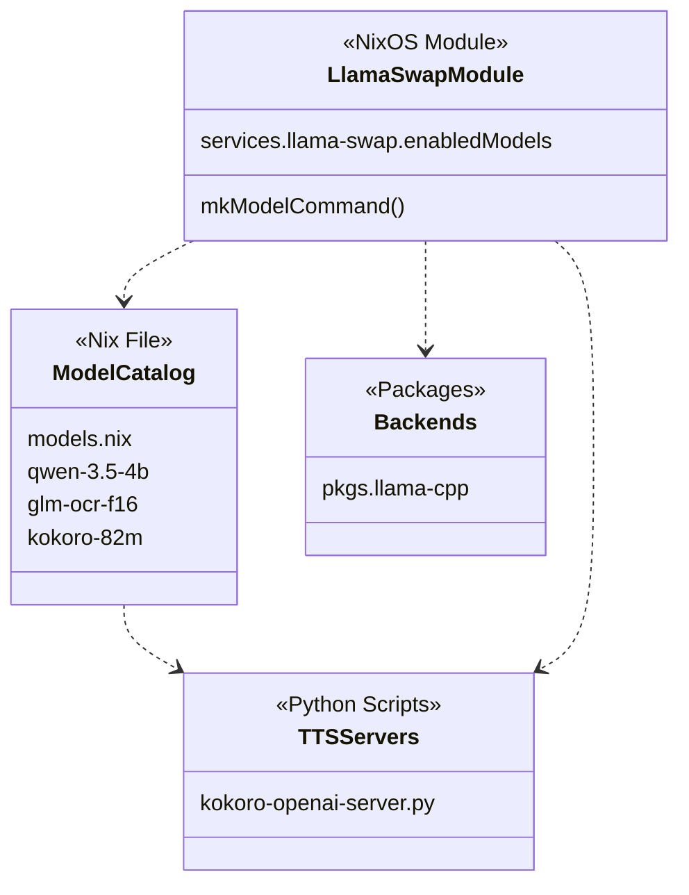

# llama-swap: LLM Orchestration Service

The `llama-swap` service is a specialized NixOS module designed to manage local LLM (Large Language Model) inference with dynamic resource allocation. It acts as an orchestration layer that allows multiple models to share a single GPU or CPU pool by swapping them in and out of memory based on demand and a Time-To-Live (TTL) mechanism.

## Service Architecture and Implementation

`llama-swap` provides a unified OpenAI-compatible API endpoint that abstracts away the complexities of model loading, backend selection (CPU or CUDA), and specific model types (Chat, Embedding, Vision, TTS).

### Core Components and Logic

The service module is `modules/ai/llama-swap/_impl/default.nix` (imported by the `llama-swap` aspect in `modules/ai/llama-swap/llama-swap.nix`). It uses a submodule system to define a structured model catalog where each model can specify its own hardware requirements and runtime parameters [modules/ai/llama-swap/_impl/default.nix](../modules/ai/llama-swap/_impl/default.nix)

Key features include:

- **TTL-based Swapping**: Models are kept alive for a specified duration after their last request. This is configured via the `ttl` option [modules/ai/llama-swap/_impl/default.nix](../modules/ai/llama-swap/_impl/default.nix)
- **Hardware Acceleration**: CUDA comes from the host-wide `nixpkgs.config.cudaSupport` (set by `codyos.hardware.nvidia`); the module has no backend switch of its own [modules/hardware/nvidia.nix](../modules/hardware/nvidia.nix)
- **Command Generation**: The `mkModelCommand` function dynamically builds the `llama-server` CLI string, incorporating parameters like context size, batch size, and GPU layers [modules/ai/llama-swap/_impl/default.nix](../modules/ai/llama-swap/_impl/default.nix)

On NAS, the matrix router allows `qwen3-embedding-0.6b` to run alongside either
the audio stack (`parakeet-tdt-v3`, `s1-mini`,
and `kokoro-82m`) or `qwen-3.5-9b`.
The audio and 9B stacks do not coexist; other models run alone. An embedding
request can therefore evict an isolated model such as the 35B. Only requested
models load, and their normal idle TTLs still apply. See [the NAS model config](../modules/ai/llama-swap/_nas-models.nix).

## Model Catalog and Types

The model catalog is centralized in `modules/ai/llama-swap/_impl/models.nix`. This file defines the hardware "footprint" for each model, ensuring they fit within the host's VRAM constraints [modules/ai/llama-swap/_impl/models.nix](../modules/ai/llama-swap/_impl/models.nix)

### Supported Model Categories

| Type           | Example Model          | Key Configuration                | Purpose                                |
| -------------- | ---------------------- | -------------------------------- | -------------------------------------- |
| **Chat**       | `qwen-3.5-4b`          | `gpuLayers = 999`                | General reasoning and conversation.    |
| **Embedding**  | `qwen3-embedding-0.6b` | `--embeddings`, `--pooling last` | Vector generation for RAG (Qdrant).    |
| **Vision/OCR** | `glm-ocr-f16`          | `mmprojFile`                     | Extracting text from images/documents. |
| **TTS**        | `kokoro-82m`           | `ttl = 0`                        | Text-to-Speech generation.             |
| **SystemOne**  | `laya`                 | passthrough only                 | Speech via `POST /upstream/laya/v1/systemone`. |

Sources: [modules/ai/llama-swap/_impl/models.nix](../modules/ai/llama-swap/_impl/models.nix)

### Laya SystemOne (passthrough, not chat completions)

Laya becomes available after native `llama.cpp >= b11361` (numeric build,
verified first b-tag containing upstream SystemOne support via
[ggml-org/llama.cpp#29818](https://github.com/ggml-org/llama.cpp/pull/29818),
which registers `/v1/systemone`) or semantic `>= 0.6.0`.
Until the locked nixpkgs `llama-cpp` reaches b11361, the NAS config keeps Laya
disabled (no fetch artifact, no enabled model, no override) via a temporary
`nativeSystemOneSupported` gate in `modules/ai/llama-swap/_nas-models.nix`.

When enabled, clients must use `POST /upstream/laya/v1/systemone` (llama-swap v249
passthrough selects Laya and forwards `/v1/systemone` unchanged). This
differs from chat completions: do not send it OpenAI chat payloads.

### Multimodal and Projector Support

For models with vision capabilities, such as `glm-ocr-f16`, the catalog must specify an `mmprojFile`[modules/ai/llama-swap/_impl/models.nix](../modules/ai/llama-swap/_impl/models.nix) This projector file is passed to `llama-server` via the `--mmproj` flag [modules/ai/llama-swap/_impl/default.nix](../modules/ai/llama-swap/_impl/default.nix)

## Hardware Acceleration Backends

`llama-swap` has no backend switch of its own. `serverPackage` defaults to `pkgs.llama-cpp`, and the Python wrappers use plain `torch`, so CUDA comes from the host-wide `nixpkgs.config.cudaSupport` set by `codyos.hardware.nvidia` [modules/hardware/nvidia.nix](../modules/hardware/nvidia.nix). The `nas` host (NVIDIA RTX 5060) uses `pkgs.unstable.llama-cpp`, which inherits that config through the overlay [modules/ai/llama-swap/_nas-models.nix](../modules/ai/llama-swap/_nas-models.nix).

## Specialized TTS Wrappers

Some models do not run directly in `llama-server` but instead use Python-based OpenAI-compatible wrappers. These are defined in the catalog by omitting the `file` attribute and providing a custom `upstream.cmd`[modules/ai/llama-swap/_impl/default.nix](../modules/ai/llama-swap/_impl/default.nix)

### Kokoro TTS Server

The `kokoro-openai-server.py` script provides an OpenAI-compatible `/v1/audio/speech` endpoint for the Kokoro model. It includes:

- **Voice Mapping**: Maps standard OpenAI voice names (e.g., `alloy`, `echo`) to Kokoro-specific voices [modules/ai/llama-swap/_impl/kokoro-openai-server.py](../modules/ai/llama-swap/_impl/kokoro-openai-server.py)
- **Offline Support**: Patches `huggingface_hub` to serve model weights and voices from local Nix store paths rather than downloading them at runtime [modules/ai/llama-swap/_impl/kokoro-openai-server.py](../modules/ai/llama-swap/_impl/kokoro-openai-server.py)

## Integration and Usage

Services within the NixOS configuration consume `llama-swap` by pointing their API base URLs to the service port (typically `8081`).

**Example: Karakeep Integration**
The Karakeep bookmark service is configured to use `llama-swap` for summarization, embedding, and OCR:

- **Base URL**: `http://nas:8081/v1`[modules/web/karakeep.nix](../modules/web/karakeep.nix)
- **Chat Model**: `qwen-3.5-4b`[modules/web/karakeep.nix](../modules/web/karakeep.nix)
- **OCR Model**: `glm-ocr-f16`[modules/web/karakeep.nix](../modules/web/karakeep.nix)
- **Embedding Model**: `qwen3-embedding-0.6b`[modules/web/karakeep.nix](../modules/web/karakeep.nix)

### Code Entity Mapping

The following diagram bridges the high-level service concepts to the specific Nix and Python entities that implement them.

**Diagram: llama-swap Code Entity Map**

