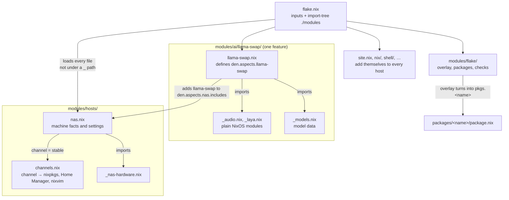

# The Den layout

CodyOS follows the [dendritic pattern](https://github.com/mightyiam/dendritic): the configuration is organized by feature, not by machine. [Den](https://github.com/denful/den) grew out of that pattern and adds its own aspect and context machinery; CodyOS uses Den to build both hosts.

## How it differs from plain NixOS

| | Plain NixOS | CodyOS |
| --- | --- | --- |
| Unit of configuration | A module per host or role, imported by `configuration.nix` | An *aspect* per feature (`den.aspects.<feature>`) |
| Turn a feature on | `services.<x>.enable = true` | The feature file adds its aspect to `den.aspects.<host>.includes` |
| Home Manager | A second tree, wired by hand | A host-scoped feature uses `provides.to-users.homeManager` to reach the host's users |
| A feature on every host | Imported by each host | The feature adds itself to `den.default.includes` |
| "Why is this on the NAS?" | Follow the imports by hand | Den traces which aspect brought it, and by which route |

A host file holds machine facts and settings such as channel, addresses, hardware, and state versions. The schema defines typed facts and applies global policies. Feature files decide where their aspects apply without needing host context for a fixed host choice.

## Why aspects

Aspects make the configuration a graph of what happens on each machine. Features are the nodes. Includes, and routes such as host → user, are the edges. Den can resolve that graph, so a person or an agent can:

- ask which feature put a service, package or setting on a host, and through which route;
- evaluate one feature alone, without the rest of the host.

That makes the system legible and testable for the agents that work on it.

## What this changes for you

- **Add or remove a feature on a machine:** edit `den.aspects.<host>.includes = [ den.aspects.<feature> ];` in the feature file, not the host file.
- **A service is in one place:** its secrets, web address, firewall rules, Homepage card and backup paths are in its own file.
- **A tool arrives complete:** the package, its configuration and the agent skill that teaches agents to use it come from one aspect.
- **Both sides of a cross-machine feature are in one file:** NFS server and client, Paperless and the beast scanner, OpenCode and its remote client. The feature file adds each side to the appropriate host's includes.
- **A new machine starts with shared features.** See [Installing a new machine](new-machine.md).

## How the files fit together

Files under a `_` path are loaded only when the owning aspect imports them. For editing conventions, see [`modules/AGENTS.md`](../../modules/AGENTS.md).
