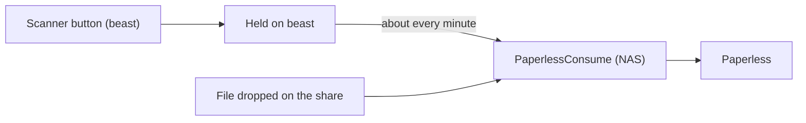

# Documents (Paperless)

Paper and PDFs go into Paperless on the NAS, at [paperless.homehub.tv](https://paperless.homehub.tv). There are two ways in: the scanner button on beast, or a file dropped on the `PaperlessConsume` share.

## Scan

1. Put the pages in the iX500 on beast.
2. Press the scanner's button.

Both sides of every page are scanned, cropped to the paper with a small margin, and joined into one PDF. It appears in Paperless about a minute later. If the NAS is unreachable, scans wait on beast and arrive once it is back.

## Drop a file

Copy a PDF or Office file to `\\smbnix\PaperlessConsume` from any LAN machine. No password. Paperless picks it up within seconds. Folders become tags: a file in `Taxes/2025/` gets the tags `Taxes` and `2025`.

## Find and edit

Open [paperless.homehub.tv](https://paperless.homehub.tv) (user `codyt`) to search, read and edit. Upload limit 100 MB.

## AI help (Paperless-GPT)

Open [paperless-gpt.homehub.tv](https://paperless-gpt.homehub.tv) and pick documents. It changes no other document.

| Action | Done by (on the NAS) |
| --- | --- |
| Read text out of a poor scan again (AI OCR) | `glm-ocr-f16` |
| Suggest a title | `qwen-3.5-9b` |

You review each suggestion before it is written back to Paperless. Paperless-GPT does not generate tags or document types.

## Changing it

| To change | Edit |
| --- | --- |
| Paperless, the share, the scanner | [`paperless.nix`](../../modules/documents/paperless.nix) |
| Paperless-GPT | [`paperless-gpt.nix`](../../modules/documents/paperless-gpt.nix) |
