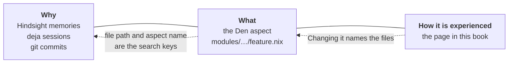

# CodyOS

CodyOS is a self-improving operating system for one person across two machines: **beast**, the desktop, and **the NAS**, the home server behind `*.homehub.tv`. It learns from prior attempts and real results, and it uses that learning in the next change. A human approves every change before it runs.

## Three views of every feature

Each feature exists three times, and the three are connected:

- **What** is the feature as declared: one [Den aspect](den-native-layout.md) that holds its system part, user part, secrets and agent skill. Den can trace which aspect put something on a machine.
- **Why** is everything that led to it. `git log -- <file>` gives the commits. Hindsight holds the distilled decisions and reasons, deja the full sessions. Search them with the aspect name or the file path.
- **How it is experienced** is this book: what you press, open or run, and what then happens. It is the baseline for "this seems wrong".

From any one view you can reach the other two. A page's *Changing it* table names the aspect's files; the files are the keys for the history. No index joins the three yet: the link is the shared file paths and names.

## The loop

1. **You notice something**, in a few words: "dictation is slow".
2. **An agent collects the three views.** It reads the page for what normal is, recalls the history, and checks the machine: [metrics, logs and outbound connections](monitoring.md).
3. **It proposes a change** to the aspect and, if what you see changes, to the page. [Checks](checks.md) run.
4. **You apply it** with [`update`](getting-started.md). It commits, switches, and pushes. Agents do not activate a system on their own.
5. **The change becomes history.** The commit records it. Claude Code and OpenCode [save each turn to Hindsight](harness.md#memory) automatically. Sessions become searchable in deja after you run `deja embed`.

The next prompt about that feature starts from all three views.

## What keeps it safe

These are the rules from the self-improving OS design, and where each one is real here:

| Rule | Here |
| --- | --- |
| All configuration is declared | Both machines are built from this repository and its locked inputs. |
| Every change traces to intent | Each `update` is a Git commit with your message; the agent session behind it is in memory. |
| No irreversible damage | Each switch is a new NixOS generation; older ones stay in the boot menu for at least 7 days. [Backups](backups.md) run nightly, on the NAS only. |
| Observable | Grafana shows what each machine runs, logs and connects to. Nothing alerts yet. |
| A human gate on changes | Agents propose diffs; you run `update`. |

## The pieces

**Agents.** [Claude Code, OpenCode, Codex and Pi](harness.md) run on both machines with one set of tools and memory. [Hermes](hermes.md) is the always-on assistant on the NAS, by voice, Telegram, Discord or terminal. [Dictation](speech.md) types into any window on beast.

**Local models.** The NAS's graphics card runs the models behind dictation, voice, [bookmark summaries and the feed curator](feeds-and-bookmarks.md), [document OCR](documents.md) and memory search. [AI tools](ai-tools.md) covers chat, memory and tracing.

**Daily use.** [Web apps](web-apps.md), [media](media.md), [documents](documents.md) and [shared files](file-sharing.md); the [desktop](desktop.md), [apps](apps.md), [theme](theming.md), [shell](shell.md) and [editor](nixvim.md).

**Upkeep.** Each night the NAS builds both machines and updates itself; each week a pull request updates the inputs ([what runs without you](getting-started.md#what-runs-without-you)). [Networking](networking.md) reaches home from anywhere.

Host notes (hardware, disks, pools): [`beast.md`](../../modules/hosts/beast.md), [`nas.md`](../../modules/hosts/nas.md). How pages are written: [Writing these docs](writing-docs.md).
