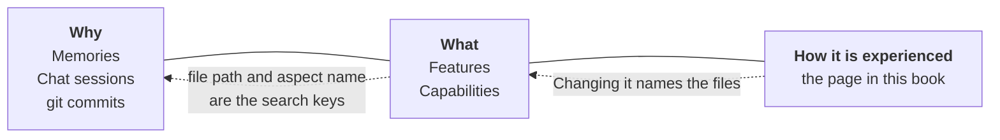

# AI is the next forcing function

We're building a self-improving operating system with declarative NixOS as its base.

Before cell phones, the most valuable thing to know was a phone number.

Carrying around an infinite Rolodex pushed us to hold more abstract, higher-value knowledge. Each shift forced the brain to take on harder problems, and that increase IQ and opened new capability.

Until now computers aren't capable of becoming the new form of Rolodex or GPS we've needed to accommodate the lower value cognitive aspects.

## The loop

Tell your agent what you notice, **Agents figure it out.**

1. **You notice something**, in a few words: "dictation feels slow".
2. **An agent collects the noise.** It reads how things should work, recalls the history, and checks the machine.
3. **It proposes a change that respects the situation.**
4. **You apply it** with [`update`](getting-started.md). It commits, switches, and pushes.
5. **The change becomes history.** Agents [extracts decisions automatically](harness.md#memory).

The next prompt about that feature starts from all three views.

[Claude Code, OpenCode, Codex and Pi](harness.md) kept in sync with the same tools, mcp, and memory. Cross agent session search lets every harness read the other's sessions.

## How it works

| Rule                          | Here                                                                                                                            |
| ----------------------------- | ------------------------------------------------------------------------------------------------------------------------------- |
| All configuration is declared | Each computer is a list of features, one [Den aspect](den-native-layout.md) per feature built.                                  |
| Every change traces to intent | Agent [memory](harness.md#memory) holds the distilled decisions and reasons behind every commit.                                |
| No irreversible damage        | Each switch is a new NixOS generation; older ones stay in the boot menu for at least 7 days. Backups run nightly. |
| Observable                    | Documentation records ideal User Experience (UX), [Monitoring tools](monitoring.md) ensures UX.                                 |
| A human gate on changes       | Agents propose diffs; you run `update`.                                                                                         |
